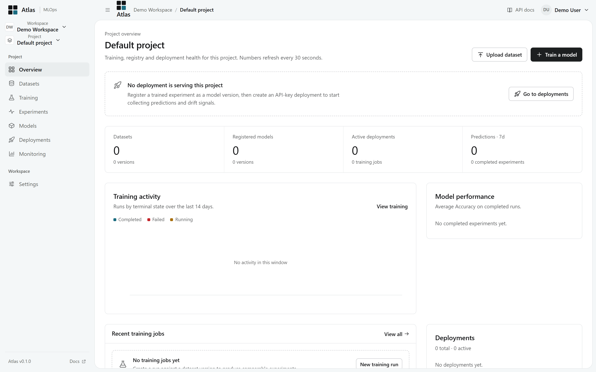
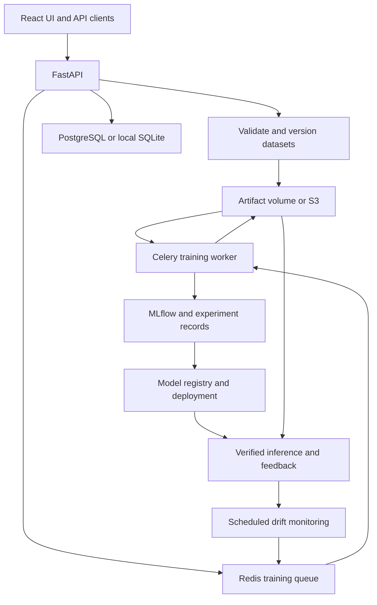
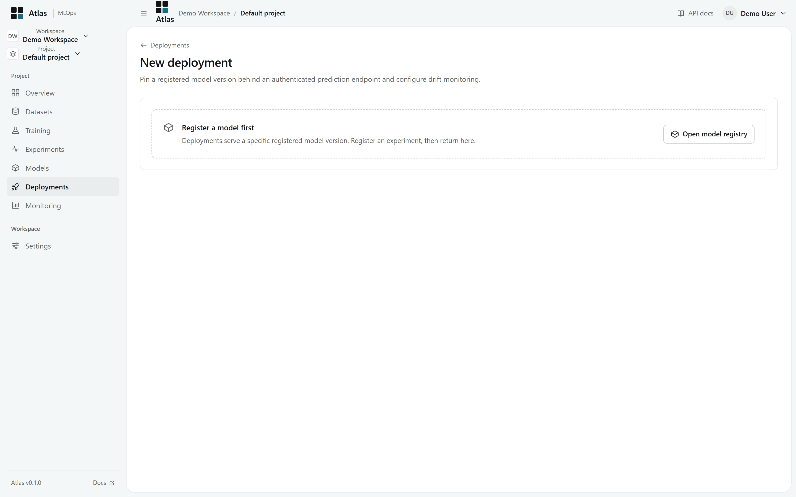
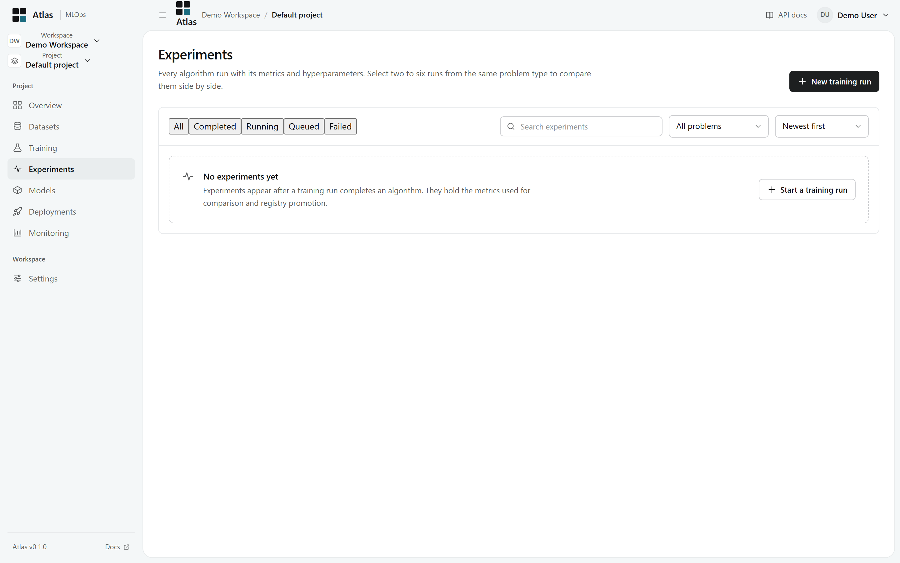
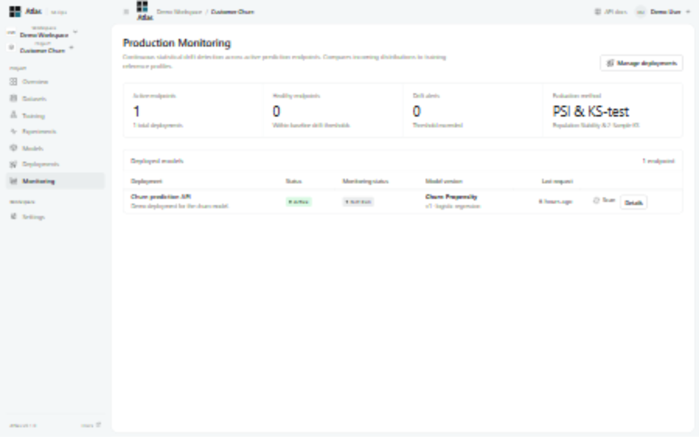

# Atlas

**Self-hosted tabular MLOps platform for training, experiment tracking, versioned registry, real-time inference, and drift monitoring.**

[](https://github.com/yuno7777/atlas-mlops/actions/workflows/ci.yml)
[](https://python.org)
[](https://fastapi.tiangolo.com)
[](https://react.dev)
[](https://mlflow.org)
[](https://docs.celeryq.dev)
[](https://docker.com)
[](LICENSE)

<br />



Atlas provides a complete machine learning lifecycle stack in a single deployable repository. It handles tabular dataset validation, multi-algorithm model training, MLflow tracking, stage-based registration, authenticated inference, and automated statistical drift detection.

---

## Highlights

- **Dataset Validation & Profiling:** Ingest CSV, Parquet, and JSON files with schema inference, MIME checks, SHA-256 integrity hashing, and baseline statistical profiling.
- **Asynchronous Training Pipeline:** Train classification, regression, and clustering jobs asynchronously with Celery + Redis, recording parameters, cross-validation metrics, and serialized artifacts in MLflow.
- **Model Registry & Stage Gates:** Maintain strict model versioning with explicit lifecycle stage transitions (`none` -> `staging` -> `production` -> `archived`).
- **Low-Latency Inference Server:** Serve predictions through FastAPI endpoints protected by hashed API keys, backed by a thread-safe LRU model cache with automatic invalidation.
- **Continuous Drift Detection:** Track incoming feature distributions with Population Stability Index (PSI) and two-sample Kolmogorov-Smirnov (KS) tests to trigger automated challenger retraining before accuracy degrades.
- **Batch Scoring & Explanations:** Score CSV uploads through a deployment, download the result file, and inspect per-record permutation Shapley contributions.
- **Controlled Champion/Challenger Traffic:** Route a configurable share of prediction requests to a second version of the same registered model and compare variants before promotion.
- **Workspace Collaboration & Lineage:** Invite members with roles, audit workspace changes, configure signed alert webhooks, and trace datasets through deployed versions.
- **Gated Progressive Releases:** Increase challenger traffic in stages with sample, error, latency, and labeled-quality gates; failed stages roll back to the champion.
- **Fairness & Model Cards:** Audit held-out subgroup metrics while keeping sensitive columns out of model features; export provenance-rich JSON or Markdown cards.
- **Benchmark Lab & Pipelines:** Run reusable classification, regression, and clustering recipes with fixed seeds, cross-validation, timing, caching, and retry history.
- **Tracing & SLOs:** Export request traces over OTLP/HTTP and inspect API availability and latency objectives from Monitoring.

---

## System Architecture



- **API and UI** handle uploads, workspace access, training submissions, registry operations, and predictions.
- **Training** verifies the dataset checksum, fits a seeded pipeline, and records evaluation metrics, model digests, and library versions. MLflow tracks runs and artifacts.
- **Registry and inference** connect experiments to deployed model versions. Serving verifies registered artifacts and validates prediction records against the trained feature schema.
- **Monitoring** compares observed inputs, predictions, and labeled feedback to reference data. Prometheus can scrape the API and Celery worker separately.

## Interface & Workflows

### 1. Project Overview & Operational Health
Monitor active deployments, recent training jobs, tracked experiments, and model inventory from a unified workspace dashboard.


### 2. Interactive Prediction Playground
Validate deployed endpoints in real time. Inspect sample payloads, execute inference, and review predicted class probabilities alongside latency metrics.



### 3. Experiment Tracking & Run Comparisons
Compare hyperparameter configurations, cross-validation metrics (ROC-AUC, F1, Log Loss, RMSE), and training artifacts across runs tracked by MLflow.



### 4. Real-Time Drift Detection & Monitoring
Monitor live feature distributions, output score shift, and statistical drift alerts (PSI and two-sample KS tests) computed against reference baselines.



---

## Tech Stack

| Layer | Technologies |
|---|---|
| **Backend API** | Python 3.12, FastAPI, Pydantic v2, SQLAlchemy 2, Alembic, Uvicorn |
| **Distributed Tasks** | Celery, Redis |
| **ML Engine** | scikit-learn, joblib, NumPy, pandas, SciPy, PyTorch (optional MLP) |
| **Experiment Tracking** | MLflow |
| **Frontend** | React 19, TypeScript, Vite, custom dark token design system |
| **Storage & DB** | PostgreSQL, SQLite (testing), Local filesystem / AWS S3 |
| **DevOps & QA** | Docker Compose, Pytest, Playwright, Ruff, Oxlint |

---

## Local quickstart

For a CPU-only run, use Python 3.12, [uv](https://docs.astral.sh/uv/), Node.js 24, and GNU Make. On Windows, use WSL for the commands below.

```bash
make setup
make train-smoke
make serve
```

The smoke test runs the full lifecycle on 30 synthetic rows with SQLite and an in-process worker. It uploads and validates data, trains two small classifiers, registers and deploys the best run, sends predictions and feedback, and exercises monitoring and retraining. It needs no Docker, Redis, or remote tracking service.

The standalone API serves [readiness](http://127.0.0.1:8000/ready) and [OpenAPI docs](http://127.0.0.1:8000/api/v1/docs). Run `npm --prefix frontend run dev` for the UI at [localhost:5173](http://localhost:5173). To populate it with the local demo, run this after the database migration performed by `make serve`.

```bash
cd backend
MLFLOW_ENABLED=false .venv/bin/python -m app.cli seed-demo
```

The demo account is `demo@atlasmlops.dev` with password `demo-password-123`. Use it only on your development instance.

## Docker Compose

Use Docker Engine with Compose v2.24.4 or later. The Compose stack also runs PostgreSQL, Redis, Celery, and the MLflow HTTP tracking server.

```bash
cp .env.example .env
# Set SECRET_KEY and POSTGRES_PASSWORD in .env to different random values.
# Generate each with: openssl rand -hex 32
CODE_REVISION=$(git rev-parse HEAD) docker compose up -d --build --wait
python3 scripts/compose_smoke.py
```

Open [the UI](http://127.0.0.1:3000), [MLflow](http://127.0.0.1:5000), or [the API metrics](http://127.0.0.1:8000/metrics). The Compose smoke check creates its own account and uses 96 rows to verify asynchronous training, MLflow, registry, and inference. Run it on a development stack with registration enabled.

For a public VPS, set `DOMAIN` and start Caddy with both Compose files. Local service ports are closed by the production overlay. See the deployment runbook for account bootstrap and upgrade steps. [Deployment runbook](docs/DEPLOYMENT.md)

```bash
docker compose -f docker-compose.yml -f docker-compose.prod.yml up -d --build --wait
```

## Configuration and operations

| Setting | Purpose and default |
| --- | --- |
| `SECRET_KEY` | Required in Compose. Standalone development has a local-only fallback. Generate at least 32 characters. |
| `POSTGRES_PASSWORD` | Required in Compose. Use URL-safe characters. Atlas and MLflow use `POSTGRES_DB` and `MLFLOW_POSTGRES_DB` respectively. |
| `DATABASE_URL`, `ARTIFACT_ROOT` | Standalone defaults to SQLite and a local artifact directory. Back up metadata and artifacts together. |
| `JOB_EXECUTION_MODE`, `REDIS_URL` | Standalone defaults to threads. Compose uses Celery with Redis and a periodic reconciliation task. |
| `MLFLOW_ENABLED`, `MLFLOW_TRACKING_URI` | Standalone tracking uses local SQLite. Compose uses the internal MLflow server. |
| `INFERENCE_THREADS`, `INFERENCE_TIMEOUT_SECONDS`, `MAX_PREDICTION_BODY_BYTES` | Defaults are 4 workers, a 10-second scoring deadline, and 2 MiB per prediction request. |
| `LOG_JSON`, `OTEL_EXPORTER_OTLP_ENDPOINT` | Request and training logs are JSON by default. Set an OTLP endpoint to export traces. |
| `ENABLE_MONITORING_SCHEDULER`, `MONITORING_INTERVAL_SECONDS` | Compose enables periodic monitoring. The default scan interval is 900 seconds. |
| `STORAGE_BACKEND`, `S3_BUCKET` | Local is the default. Configure S3 storage and bucket permissions together when using object storage. |

Use the same `Idempotency-Key` when retrying a training submission after a transport failure. Each key is scoped to the project and submitting user. A changed request with the same key returns `409`. Keep the recorded dataset and model SHA-256 digests, seed, code revision, and Python package versions with the run.

- **Readiness returns 503.** Check the named dependency in `/ready`. Celery mode checks Redis as well as PostgreSQL and artifact storage.
- **A training job remains queued.** Check Redis, the worker, and beat. Reconciliation republishes old queued jobs. A stale running job is marked failed and can be resubmitted with a new idempotency key.
- **A model returns 503.** Check the deployment state and registry artifact digest, restore verified bytes from backup, or register a fresh run. A busy inference pool also returns 503. Scoring deadlines return 504.
- **Drift is missing from Grafana.** Scrape the API at `backend:8000/metrics` and the Celery worker at `worker:9101/metrics` from the Compose network. Use `atlas_http_requests_total`, `atlas_http_request_duration_seconds`, and `atlas_drift_signals_total` for request and drift panels.

## Synthetic Model Benchmarks

The repository includes six reproducible synthetic datasets with 3,000 rows each:
SaaS churn, loan repayment risk, e-commerce conversion, retail demand, delivery ETA,
and used vehicle prices. Three are classification tasks and three are regression
tasks. Their feature columns include a small, intentional amount of missing data to
exercise Atlas preprocessing. Training fits numeric median imputation and scaling,
plus categorical most-frequent imputation and one-hot encoding within each split.

After starting Atlas and seeding the demo account, generate, upload, and train them
from the repository root:

```bash
python demo-data/generate_mock_datasets.py
python demo-data/run_mock_benchmarks.py
```

The workflow creates a `Synthetic Model Benchmarks` project, runs two algorithms per
dataset with an 80/20 holdout and 3-fold cross-validation, and compares each pair of
experiments. Dataset descriptions, preprocessing notes, and the resulting metrics are
in [demo-data/mock-benchmarks](demo-data/mock-benchmarks/README.md). The data is
synthetic and intended for pipeline testing, not production decisions.

### Popular model and pipeline recipes

The authenticated **Benchmark Lab** page offers reusable recipes for common tabular
baselines:

| Recipe | Popular models | Main comparison metrics |
|---|---|---|
| Classification baselines | Logistic Regression, Random Forest, Gradient Boosting | Accuracy, weighted F1, ROC AUC |
| Imbalanced classification | Class-weighted Logistic Regression, Random Forest, Gradient Boosting | Weighted F1, ROC AUC, accuracy |
| Regression baselines | Linear Regression, Ridge, Random Forest, Gradient Boosting | R-squared, RMSE, MAE |
| Small-data regression | Ridge, constrained Random Forest, Gradient Boosting | R-squared, RMSE, MAE |
| Clustering baseline | K-Means | Silhouette, Davies-Bouldin, Calinski-Harabasz |

Supervised runs compare models on the same dataset version and seeded holdout, with
cross-validation computed on the training partition. The page records CV mean and
spread, held-out metrics, training time, subgroup fairness results when requested, and
the full pipeline attempt history. The API contract and generated synthetic results
are documented in [docs/API_SPECIFICATION.md](docs/API_SPECIFICATION.md) and
[demo-data/mock-benchmarks](demo-data/mock-benchmarks/README.md).

## Testing and code quality

```bash
make lint typecheck test train-smoke audit
make docker-build
npx --prefix frontend playwright install chromium
npm --prefix frontend run e2e
```

The browser suite builds the frontend, applies Alembic migrations to an isolated SQLite database, and exercises invitation, monitoring, scoring, and lineage flows. GitHub Actions validates both Compose configurations and builds the images before testing PostgreSQL, Redis, Celery, MLflow, and prediction through the frontend proxy.

## Core Capabilities

### Tabular Dataset Profiling
- Upload CSV, Parquet, or JSON datasets with automatic MIME and extension verification.
- Calculates row counts, column types, null percentages, unique value counts, and cardinality.
- Generates SHA-256 checksums to ensure dataset version immutability.

### Training & Algorithms
- **Classification:** Logistic Regression, Random Forest, Decision Tree, Gradient Boosting, SVM, KNN, PyTorch MLP.
- **Regression:** Linear Regression, Ridge, Random Forest, Gradient Boosting, SVR.
- **Clustering:** K-Means, DBSCAN.
- Automatic metric logging: ROC-AUC, Precision, Recall, F1 score, Accuracy, Log Loss, RMSE, MAE, R-squared, Silhouette score.

### Deployment & Serving
- Deploy any registered model version to a dedicated REST endpoint.
- Authenticate external scoring requests using hashed `X-API-Key` headers.
- Thread-safe `ModelCache` loads models into memory on first request with LRU eviction and TTL expiry.
- Every prediction request logs input features, output probability scores, and latency in milliseconds.

### Drift & Continuous Monitoring
- **Data Drift:** Compares incoming feature distributions against training reference profiles using Population Stability Index (PSI) and two-sample Kolmogorov-Smirnov (KS) tests.
- **Concept Drift:** Tracks ground-truth feedback against prior predictions to detect performance regression.
- **Automated Challenger Retraining:** Triggers new training runs when drift thresholds are breached, with cooldown guards preventing duplicate retraining jobs.

---

## Repository Documentation

Detailed engineering documentation and architecture decision records:

- [docs/ARCHITECTURE.md](docs/ARCHITECTURE.md): System architecture, process boundaries, and concurrency model.
- [docs/API_SPECIFICATION.md](docs/API_SPECIFICATION.md): REST endpoints, request/response schemas, and error codes.
- [docs/DATABASE_SCHEMA.md](docs/DATABASE_SCHEMA.md): Relational tables, indexes, constraints, and relationships.
- [docs/ML_PIPELINE.md](docs/ML_PIPELINE.md): Data preprocessing, algorithm configs, and drift mathematics.
- [docs/TESTING_STRATEGY.md](docs/TESTING_STRATEGY.md): Testing pyramid, fixtures, and verification strategy.
- [docs/DEPLOYMENT.md](docs/DEPLOYMENT.md): Production deployment guides and environment variables.
- [docs/SECURITY.md](docs/SECURITY.md): Authentication, RBAC, input validation, and secret handling.
- [docs/decisions/](docs/decisions/): Architecture Decision Records (ADR-001 to ADR-004).

---

## License

This project is licensed under the MIT License.
