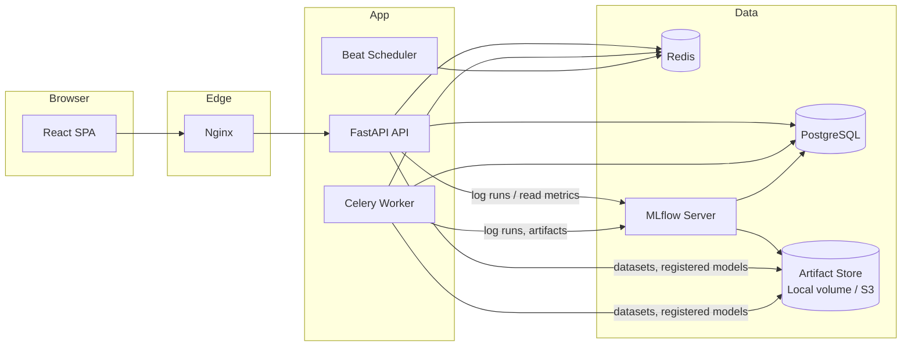
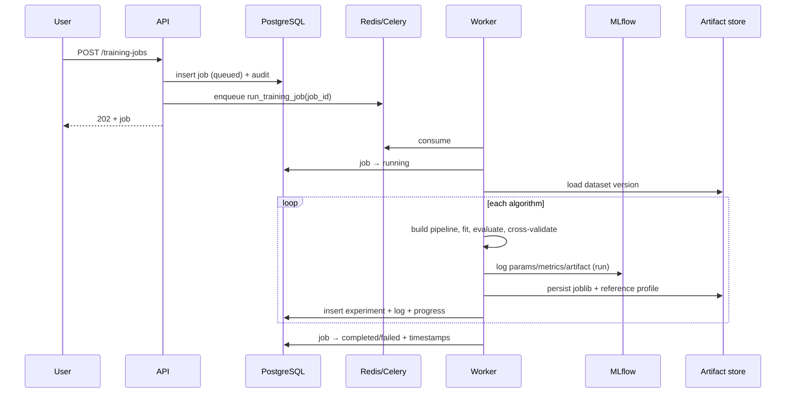
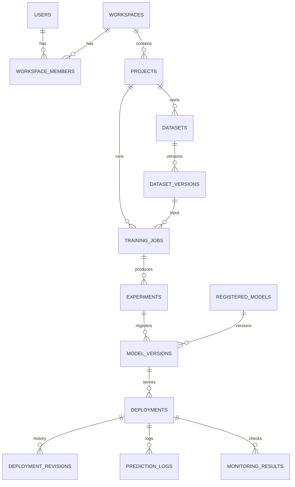

# Architecture

## 1. Overview

Atlas is a modular monolith with a dedicated worker process. It optimizes for a
single-team, single-machine deployment while keeping boundaries clear enough to split
later. No service boundaries are drawn that would require distributed transactions.



### Components

| Component | Responsibility | Does not |
|---|---|---|
| React SPA | Presentation, forms, polling, charts | Compute metrics, infer truth |
| FastAPI | Contracts, auth, validation, orchestration | Contain SQL or model logic in handlers |
| Services | Use cases, transactions, audit | Contain HTTP concerns |
| Repositories | SQL queries and persistence | Business rules |
| ML package | Dataset profiling, training, inference, drift | Touch HTTP or DB sessions |
| Worker | Long-running training/monitoring | Serve predictions |
| MLflow | Run params/metrics/artifacts, experiment UI | Act as the app system of record |
| PostgreSQL | All app entities, prediction/monitoring/audit records | Store large raw files |
| Artifact store | Datasets, serialized models, reference profiles | Serve public URLs |

## 2. Layering Rules

```text
api (HTTP) → services (use cases) → repositories (SQL) → models (entities)
                    ↘ ml (pure functions/classes)  ↘ core (cross-cutting)
```

- Route handlers never instantiate SQLAlchemy queries or scikit-learn estimators.
- ML code accepts dataframes and configuration; it does not know about FastAPI,
  workspaces, or HTTP status codes.
- Services own transaction boundaries. Repositories flush; services commit.
- Pydantic response schemas are explicit; ORM objects are never returned directly.
- All authorization checks happen in services or dependencies, never trusted from
  the client.

## 3. Request Lifecycle

1. Nginx serves the SPA; `/api/*` is proxied to FastAPI.
2. Middleware assigns/propagates `X-Request-ID`, measures latency, and emits an access
   log. Prometheus middleware counts requests by route, method, and status.
3. Dependencies resolve the bearer token, user, workspace membership, and project.
4. The route validates input via Pydantic, delegates to a service, and returns a typed
   response envelope or a structured error.
5. Errors use one shape: `{"error": {"code", "message", "details", "request_id"}}`.
6. A global handler maps domain exceptions to 4xx and unexpected exceptions to 500,
   logging a stack trace without leaking internals.

## 4. Async Training



- In Docker Compose, `JOB_EXECUTION_MODE=celery`; Redis is the broker and Celery Beat
  schedules monitoring scans.
- For local development or tests, `JOB_EXECUTION_MODE=thread` uses a bounded
  `ThreadPoolExecutor` and the same `TrainingRunner` service. `JOB_EXECUTION_MODE=sync`
  executes inline for deterministic tests. The execution contract is identical.
- Each job is claimed atomically (`UPDATE ... WHERE status='queued'`) to avoid duplicate
  execution if a task is delivered twice. Progress and logs are committed frequently.
- Cancellation is a flag checked between algorithms and stages. It is cooperative by
  design; forcibly killing a worker mid-fit can corrupt state.

## 5. Model Serving

- Deployments pin a `model_version_id`. Activating a version writes a deployment
  revision, enabling rollback.
- Models are never deserialized from user-supplied paths. The registry copies the
  artifact to a platform-controlled key, computes a SHA-256 digest, and records the
  key. Loading verifies both the key containment and the digest.
- A process-local `ModelCache` (LRU, TTL, RLock) holds deserialized pipelines. Cache
  keys include deployment ID, model version ID, and artifact digest. Eviction closes
  nothing because sklearn estimators hold no OS resources; the object is released.
- Concurrent requests per deployment share one load via a per-key load lock.
- Each prediction writes one row to `prediction_logs` with latency, status, and the
  request feature payload (capped), which powers drift analysis.
- Prediction authentication: deployment API key (`X-API-Key`, stored as SHA-256) for
  external callers, or a JWT with workspace membership for the console.

## 6. Monitoring and Drift

Reference data is captured at registration time:

- Numeric features: quantile bin edges + proportions (10 bins).
- Categorical features: top value frequencies + "other" bucket.
- Prediction baseline: predicted class distribution or prediction quantiles from the
  held-out test set.
- Performance baseline: the held-out test metrics.

On each scan, recent predictions are compared to reference:

| Signal | Method | Meaning |
|---|---|---|
| Data drift (numeric) | PSI (10 bins) + two-sample KS | Input distribution shift |
| Data drift (categorical) | PSI over value buckets | Input category shift |
| Prediction drift | PSI vs baseline prediction distribution | Output distribution shift |
| Concept drift | Rolling labeled performance vs baseline; >= min labels | Input→output relationship change; only with ground truth |

Overall status is `critical` if drift share exceeds the deployment threshold or labeled
performance degrades beyond its threshold; `warning` if PSI exceeds the per-feature
threshold; otherwise `healthy`. Insufficient samples produce `insufficient_data`, not a
false healthy signal. Thresholds are stored per deployment and are configurable.

Drift-triggered retraining enqueues a challenger job once per cooldown window when
enabled. **Promotion is always an explicit human action.**

## 7. Data Model

See [DATABASE_SCHEMA.md](DATABASE_SCHEMA.md). Principal relationships:



## 8. Storage Layout

```text
ARTIFACT_ROOT/
├── datasets/{dataset_id}/v{version}/{sha256}.{ext}
├── training/{job_id}/{experiment_id}/model.joblib
├── training/{job_id}/{experiment_id}/reference_profile.json
├── registry/{registered_model_id}/v{version}/model.joblib
└── registry/{registered_model_id}/v{version}/reference_profile.json
```

Paths are relative keys in the database. Public APIs never expose filesystem paths;
downloads stream through authorized endpoints and log an audit event.

S3-compatible storage mirrors the same keys. Configuration:

```env
STORAGE_BACKEND=local            # or s3
ARTIFACT_ROOT=./data/artifacts
S3_ENDPOINT_URL=                 # blank for AWS S3
S3_BUCKET=atlas-artifacts
S3_REGION=us-east-1
AWS_ACCESS_KEY_ID=...
AWS_SECRET_ACCESS_KEY=...
```

## 9. Security Boundaries

- Uploads: extension + MIME allowlist, configurable byte limit, parsed in-memory with
  a hard row cap for profiling; malformed files fail closed.
- Authentication: bcrypt hashes, HS256 JWTs with expiry; no refresh tokens in this
  iteration (documented limitation).
- Authorization: every project-scoped endpoint resolves workspace membership; viewers
  are read-only.
- Model artifacts: platform-generated only; integrity check before load; trust boundary
  documented (joblib is pickle-based — only trusted platform artifacts are loaded).
- Prediction endpoints: API-key auth for external use; per-deployment rate limit.
- No secrets in code or logs; `.env` is git-ignored; `.env.example` holds placeholders.
- Audit trail for login, dataset upload, training, registry promotion, deployment
  changes, downloads, and feedback.

## 10. Scaling Path (documented, not prematurely built)

1. Scale API replicas behind the Nginx/ingress; make the rate limiter Redis-backed.
2. Scale Celery workers; move training to dedicated queues and resource limits.
3. Replace local artifacts with S3; enable MLflow artifact proxy or S3 artifact root.
4. Add a shared cache (Redis) for models if request volume warrants it; keep integrity
   verification.
5. Partition prediction logs by month and aggregate drift counters.
6. Add managed Postgres, connection pooling (PgBouncer), and backups.

## 11. Failure Modes

| Failure | Behavior |
|---|---|
| MLflow unavailable | Training continues; experiment row records `mlflow_run_id=null` and a warning log. UI shows "Tracking unavailable" for that run. |
| Redis unavailable at enqueue | Job creation fails with 503 and a clear message (Celery mode). Thread mode has no Redis dependency. |
| Model artifact missing/corrupt | Deployment health is `unhealthy`; predictions return 503; event recorded. |
| Worker dies mid-job | Job remains `running`; a startup recovery pass marks jobs older than the stale threshold as failed (documented operational step). |
| Drift scan with too few rows | Result `insufficient_data`; no retraining trigger. |
| Dataset parse failure | Upload rejected; no dataset version row left in `ready` state. |
