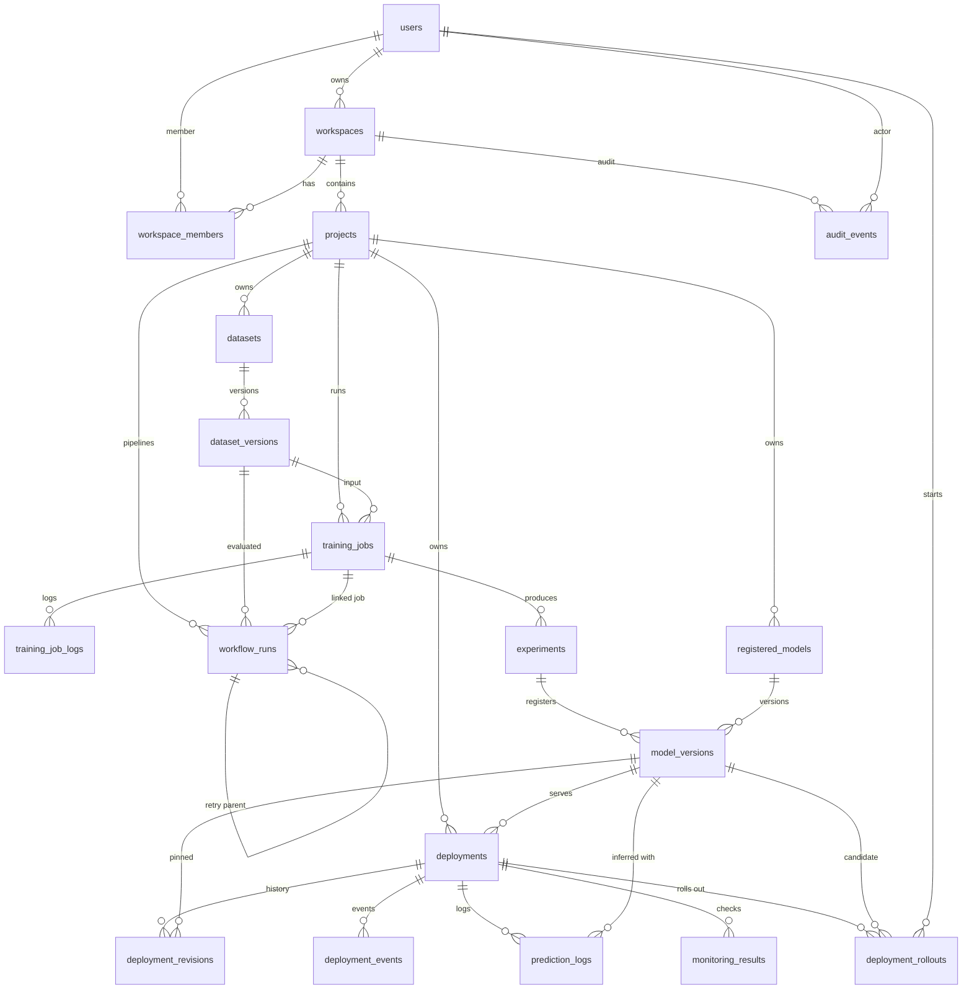

# Database Schema

PostgreSQL 16 is the production/local Compose database. SQLite is supported for tests
and a no-Docker developer mode. Types are portable (string UUIDs, generic JSON,
timezone-aware timestamps) to keep both paths identical.

## Conventions

- Primary keys: UUIDv4 strings (`CHAR(36)` in SQLite, `VARCHAR(36)` in PostgreSQL) for
  readable, non-guessable public IDs.
- Timestamps: `TIMESTAMP WITH TIME ZONE`, server default `now()`, updated on write
  where applicable.
- JSON: JSONB in PostgreSQL via SQLAlchemy `JSON` (uses JSON on SQLite in tests).
- FKs: explicit `ondelete`; SQLite tests enable `PRAGMA foreign_keys=ON`.
- All application tables include `created_at`; mutable entities include `updated_at`.
- Names are snake_case; indexes use `ix_<table>_<columns>`.
- Alembic owns schema creation. `create_all` is used only in tests.

## Entity Relationship Diagram

## Tables

### users

| Column | Type | Notes |
|---|---|---|
| id | string PK | UUID |
| email | string(320) | unique, lowercased, indexed |
| password_hash | string(255) | bcrypt |
| full_name | string(120) | |
| is_active | bool | default true |
| created_at, updated_at | timestamptz | |

### workspaces

| Column | Type | Notes |
|---|---|---|
| id | string PK | |
| name | string(120) | |
| slug | string(140) | unique |
| owner_id | FK users.id | `ON DELETE RESTRICT` |
| created_at | timestamptz | |

### workspace_members

| Column | Type | Notes |
|---|---|---|
| workspace_id | FK workspaces.id | PK part, cascade |
| user_id | FK users.id | PK part, cascade |
| role | string(16) | `owner`, `admin`, `member`, `viewer` |
| created_at | timestamptz | |

Unique (workspace_id, user_id). Index on user_id.

### projects

| Column | Type | Notes |
|---|---|---|
| id | string PK | |
| workspace_id | FK workspaces.id | cascade |
| name | string(120) | |
| slug | string(140) | unique per workspace |
| description | text nullable | |
| created_at, updated_at | timestamptz | |

Unique (workspace_id, slug). Index workspace_id.

### datasets

| Column | Type | Notes |
|---|---|---|
| id | string PK | |
| project_id | FK projects.id | cascade |
| name | string(120) | unique per project |
| description | text nullable | |
| latest_version | int | denormalized for lists |
| created_by | FK users.id | restrict |
| created_at, updated_at | timestamptz | |

Unique (project_id, name). Index project_id.

### dataset_versions

| Column | Type | Notes |
|---|---|---|
| id | string PK | |
| dataset_id | FK datasets.id | cascade |
| version | int | unique per dataset |
| status | string(16) | `processing`, `ready`, `failed` |
| storage_key | string(500) | platform-relative |
| checksum | string(64) | SHA-256 |
| size_bytes | bigint | |
| row_count | int | |
| column_count | int | |
| original_filename | string(255) | sanitized display only |
| content_type | string(120) | detected |
| schema_json | JSON | columns/dtypes/kinds |
| profile_json | JSON | stats, missing, duplicates |
| preview_json | JSON | first 25 rows |
| validation_json | JSON | checks and target suggestions |
| error_message | text nullable | failed uploads |
| created_by | FK users.id | |
| created_at | timestamptz | |

Unique (dataset_id, version). Index (dataset_id, created_at DESC).

### training_jobs

| Column | Type | Notes |
|---|---|---|
| id | string PK | |
| project_id | FK projects.id | cascade |
| dataset_version_id | FK dataset_versions.id | restrict/null on set? restrict while jobs exist |
| name | string(160) | |
| problem_type | string(20) | classification/regression/clustering |
| target_column | string(255) nullable | |
| feature_columns | JSON | list or null (all) |
| algorithms | JSON | validated catalog entries |
| config | JSON | test_size, seed, cv, split strategy |
| status | string(16) | queued/running/completed/failed/cancelled |
| progress | int | 0–100 |
| status_message | string(255) nullable | current stage |
| error_message | text nullable | |
| cancel_requested | bool | default false |
| retrain_source_deployment_id | FK deployments.id nullable | `ON DELETE SET NULL` |
| mlflow_experiment_id | string(64) nullable | |
| created_by | FK users.id | |
| started_at, completed_at | timestamptz nullable | |
| created_at, updated_at | timestamptz | |

Indexes: (project_id, created_at DESC), (status), (dataset_version_id).

### training_job_logs

| id | bigint identity PK |
|---|---|
| job_id | FK training_jobs.id cascade |
| level | string(10) |
| message | text |
| created_at | timestamptz |

Index (job_id, id).

### experiments

Each row is one **algorithm run** inside a training job. This is the unit compared in
the Experiments UI and the unit registered in the model registry.

| Column | Type | Notes |
|---|---|---|
| id | string PK | |
| project_id | FK projects.id | cascade |
| training_job_id | FK training_jobs.id | cascade |
| dataset_version_id | FK dataset_versions.id | restrict |
| name | string(200) | `${job.name} · ${algorithm_label}` |
| algorithm | string(64) | catalog id |
| algorithm_label | string(120) | display name |
| problem_type | string(20) | |
| params | JSON | hyperparameters + split config |
| metrics | JSON | problem-type-aware |
| cv_metrics | JSON nullable | mean/std per metric |
| status | string(16) | running/completed/failed/cancelled |
| error_message | text nullable | |
| mlflow_run_id | string(64) nullable | |
| tracking_warning | text nullable | degraded-mode reason |
| artifact_key | string(500) nullable | serialized pipeline |
| reference_profile | JSON nullable | drift baseline |
| training_duration_seconds | float nullable | |
| started_at, completed_at | timestamptz nullable | |
| created_at | timestamptz | |

Indexes: (project_id, created_at DESC), (training_job_id), (algorithm), (status),
(problem_type).

### registered_models

| Column | Type | Notes |
|---|---|---|
| id | string PK | |
| project_id | FK projects.id | cascade |
| name | string(120) | unique per project |
| description | text nullable | |
| latest_version | int | |
| created_by | FK users.id | |
| created_at, updated_at | timestamptz | |

### model_versions

| Column | Type | Notes |
|---|---|---|
| id | string PK | |
| registered_model_id | FK registered_models.id | cascade |
| version | int | unique per model |
| experiment_id | FK experiments.id | restrict (one version per experiment per model) |
| dataset_version_id | FK dataset_versions.id | restrict |
| algorithm, framework | string | |
| stage | string(16) | `none`, `staging`, `production`, `archived` |
| metrics | JSON | snapshot |
| params | JSON | snapshot |
| artifact_key | string(500) | platform registry copy |
| artifact_sha256 | string(64) | integrity |
| reference_profile | JSON | drift baseline |
| created_by | FK users.id | |
| created_at, updated_at | timestamptz | |

Unique (registered_model_id, version). Unique (registered_model_id, experiment_id) to
prevent duplicate registration. Index (registered_model_id, stage).

### deployments

| Column | Type | Notes |
|---|---|---|
| id | string PK | |
| project_id | FK projects.id | cascade |
| registered_model_id | FK registered_models.id | restrict |
| model_version_id | FK model_versions.id | restrict |
| name | string(140) | unique per project |
| description | text nullable | |
| status | string(16) | `active`, `stopped`, `failed` |
| api_key_hash | string(64) | SHA-256; plaintext returned once |
| api_key_prefix | string(12) | display only |
| config | JSON | thresholds, auto retrain policy |
| last_request_at | timestamptz nullable | |
| activated_at, stopped_at | timestamptz nullable | |
| last_retrain_at | timestamptz nullable | cooldown |
| created_by | FK users.id | |
| created_at, updated_at | timestamptz | |

### deployment_revisions

| Column | Type | Notes |
|---|---|---|
| id | string PK | |
| deployment_id | FK deployments.id | cascade |
| model_version_id | FK model_versions.id | restrict |
| activated_at, deactivated_at | timestamptz | |
| reason | string(64) | `initial`, `rollback`, `manual` |
| created_by | FK users.id | |

Index (deployment_id, activated_at DESC).

### deployment_events

| id | bigint PK |
|---|---|
| deployment_id | FK deployments.id cascade |
| level | string(10) |
| message | text |
| metadata | JSON |
| created_at | timestamptz |

### prediction_logs

| Column | Type | Notes |
|---|---|---|
| id | string PK | also the public prediction id |
| deployment_id | FK deployments.id | cascade |
| model_version_id | FK model_versions.id | restrict |
| request_id | string(36) | |
| features | JSON | request payload, capped at 32 KB; null if too large |
| prediction | JSON | model output |
| status | string(16) | success/error |
| error_message | text nullable | |
| latency_ms | float | |
| actual | JSON nullable | ground truth |
| actual_received_at | timestamptz nullable | |
| created_at | timestamptz | |

Indexes: (deployment_id, created_at DESC), (deployment_id, status, created_at),
(created_at). Ground-truth feedback updates at most once per row.

### monitoring_results

| Column | Type | Notes |
|---|---|---|
| id | string PK | |
| deployment_id | FK deployments.id | cascade |
| model_version_id | FK model_versions.id | restrict |
| status | string(24) | healthy/warning/critical/insufficient_data |
| sample_count | int | recent predictions in window |
| labeled_count | int | with ground truth |
| data_drift_detected | bool | |
| prediction_drift_detected | bool | |
| concept_drift_detected | bool | only with labels |
| drift_share | float | fraction of drifted features |
| psi_max | float | |
| ks_min_pvalue | float nullable | |
| details | JSON | per-feature PSI/KS, prediction drift, performance |
| created_at | timestamptz | |

Index (deployment_id, created_at DESC).

### audit_events

| Column | Type | Notes |
|---|---|---|
| id | bigint PK | |
| workspace_id | FK workspaces.id | cascade |
| project_id | FK projects.id nullable | set null |
| user_id | FK users.id nullable | set null (system actions) |
| action | string(64) | e.g. `dataset.uploaded` |
| resource_type | string(64) | |
| resource_id | string(64) nullable | |
| metadata | JSON | non-sensitive |
| ip_address | string(45) nullable | |
| created_at | timestamptz | |

Index (workspace_id, created_at DESC), (action).

### deployment_rollouts

| Column | Type | Notes |
|---|---|---|
| id | string PK | UUID |
| deployment_id | FK deployments.id | cascade |
| candidate_version_id | FK model_versions.id | restrict |
| status | string(20) | running/promoted/rolled_back/cancelled |
| traffic_steps | JSON | Increasing candidate traffic percentages, ending at 100 |
| current_step | int | Current rollout stage index |
| gates | JSON | Sample, error-rate, latency, label-count, and quality thresholds |
| last_evaluation | JSON | Most recent gate evidence and decision |
| started_at, step_started_at | timestamptz | Rollout and current-stage start |
| last_evaluated_at, completed_at | timestamptz nullable | Evaluation and terminal timestamps |
| created_by | FK users.id | restrict |
| created_at, updated_at | timestamptz | |

Indexes: (deployment_id, status) and a partial unique index on `deployment_id` where
`status = 'running'`, allowing at most one active rollout per deployment.

### workflow_runs

| Column | Type | Notes |
|---|---|---|
| id | string PK | UUID |
| project_id | FK projects.id | cascade |
| dataset_version_id | FK dataset_versions.id | restrict |
| training_job_id | FK training_jobs.id nullable | set null; generated training/benchmark job |
| parent_run_id | FK workflow_runs.id nullable | set null; previous retry attempt |
| template_id | string(80) | Versioned-in-code reusable recipe identifier |
| name | string(160) | User-facing run name |
| status | string(20) | queued/scheduled/running/completed/failed/cancelled |
| step_states | JSON | Pipeline step state and detail |
| config | JSON | Effective training, split, fairness, and recipe settings |
| cache_key | string(64) | SHA-256 dataset checksum and stable configuration |
| cache_hit | bool | True if an identical successful run was reused |
| attempt, max_attempts | int | Retry count and configured limit |
| scheduled_at, started_at, completed_at | timestamptz nullable | Execution timestamps |
| error_message | text nullable | Failure detail |
| created_by | FK users.id | restrict |
| created_at, updated_at | timestamptz | |

Indexes: (project_id, created_at), (status, scheduled_at), and
(project_id, cache_key, status).

## Cascading Behavior

- Deleting a workspace cascades membership, projects, datasets, jobs, experiments,
  models, deployments, logs, monitoring, audit.
- Deleting a dataset is blocked if any model version references its versions
  (`409`), but training jobs/experiments cascade with the dataset if it is removed.
  In practice the API refuses dataset deletion when versions are referenced by model
  versions or deployments, and documents that historical runs are removed.
- Registered models with deployments/versions cannot be deleted via API (no delete
  endpoint in this iteration); archive instead.
- Experiments are never deleted; jobs and their experiments are immutable history.
- `prediction_logs` cascade with deployment deletion (audited).

## Index and Query Notes

- Hot list queries filter by `project_id` and order by `created_at DESC`, matching
  composite indexes.
- Prediction log retention is a documented operational concern, not automatically
  pruned in this iteration.
- The dashboard requires bounded queries (last 30 days) to avoid unbounded scans.
